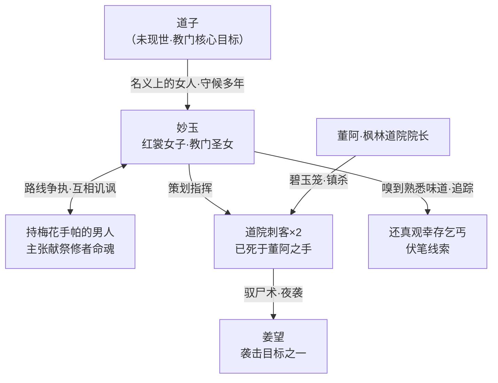

# 神秘教门

> 「忘川河底，白骨已沉寂太久！不能再有意外了！」
> —— 妙玉（还真观密谈）

## 核心简介

神秘教门是一个潜伏于庄国枫林城一带的隐秘左道组织，正式教名尚未在原著中揭晓。其成员行事诡秘、手段酷烈，以**活人献祭**为请示"神旨"的手段，并将寻找现世的"**道子**"视为头等大事。该教门已存在**数千年之久**，历代皆设有"圣女"侍奉道子。

教门行事风格极端：为达成目的不惜以凡人乃至修者的性命为祭品，甚至敢在庄国国立修行机构——枫林道院——之内公然行凶，以试探官方强者的实力与底线。其左道手段包括**驭尸术**（操纵无头尸体与"摇断头"的飞头伤人）以及**水行道术**（头颅自爆时以水膜包裹血肉）等，所涉邪异之术恐怕不止于此。

> **注**：截至原著第 10 章，该组织的真实名称、神祇信仰与教义全貌均未揭示，本词条以"神秘教门"代称，内容仅基于已揭示剧情整理。

---

## 关键事件

### 一、夜袭枫林道院（第 8-9 章）

- 姜望在外门宿舍过道中拦住一名"外门弟子"询问凌河下落，对方答话间竟"摇断了头"——头颅落地弹起、无头尸体张臂扑杀，对姜望发动突袭。整个过道被一层透明元气隔膜封闭，形成**围杀之局**。
- 姜望以蹴鞠般的空中反抽击退飞头（脚背被撕咬下一块肉，伤口隐泛青色，疑为**尸毒**），再以爆开道元撞破元气隔膜脱困。宿舍区随后发现一名真正的外门弟子遇害，头颅与尸身分离、面目狰狞。
- 姜望判断袭击者"至少有偏于左道的驭尸术，和正统的水行道术"，且**对手不止一人**。
- 道院院长董阿（五品强者）施展道术"**碧玉笼**"，令整座道院的木制品异变、彻底封锁全院：
  - 一名苍白的刺客身影腾空欲逃，被无数木刺当场穿身射杀；
  - 另一名刺客被木手擒至董阿面前，却在问询前**自爆头颅**灭口——其头颅爆开时董阿以水膜包裹血肉，并令巨花吞掉两具尸体毁尸灭迹。
- 董阿震怒宣言彻查到底，城主魏去疾遥相回应"定杀不饶"。姜望意识到此案背后暗流汹涌，左道行凶于道院，或含**试探官方反应**之意，庄国并不太平。

### 二、还真观密谈——教门真容初现（第 10 章）

左光烈陨落之地、残破的还真观，成为教门两名核心人物的密谈之所。月光之下，两人面色惨白：

- 红裳女子**妙玉**与一名持绣梅手帕、掩住口鼻的**神秘男人**在破观香案前议事。
- 观中乞儿"死绝"，缺少祭品，无法**请神旨**；男人提议直接献祭**一个修者的命魂**，称"这城里有一个算一个，早晚都是要死的"，妙玉则以会引来道院清剿为由反对，主张低调。
- 两人道出教门当前的两大核心议程：
  1. **寻找道子**——"在道子现世之前"必须保持低调，"现在又来了个董阿，咱们必须尽快找到道子"；
  2. **重续献祭**——秦楚两国的修士在枫林城附近乱斗，搅得还真观的献祭无法进行，左光烈的死更是意外破坏了教门的献祭计划。
- 男人指责**袭击枫林道院正是妙玉的主意**，闹得满城风雨、可能坏了大事；妙玉则辩称：为了教门大计，必须**明确董阿的实力和底线**，"一定的牺牲在所难免"。
- 妙玉自陈在枫林道院中嗅到了"熟悉的味道"——**还真观里的乞丐并未死绝**，有人活着进入了道院，此线索成为后续剧情的伏笔。
- 密谈尾声，妙玉独自留在破观中喃喃自语："他怎会不爱我？怎会不要我？我守了这么多年，等了这么多年……"——道出其为道子守候多年的执念。

---

## 核心成员

### 妙玉

- **身份**：教门圣女（推断），"名义上是道子的女人"。
- **形象**：一袭红衣，身量极妙、凹凸有致，面色苍白却艳丽惊人，红唇鲜艳；毫不介意地坐在布满灰尘的香案上，坦然自若。
- **性格与手段**：妩媚中透着狠辣与傲慢——嘲讽同伴为"蠢货"，主张为教门大计可以牺牲教众；言语间充满杀伐随意（"找死的法子并不是只有一种，你何必拘泥于此呢？拔剑割喉不好么？或者引雷噬身？"）。
- **执念**：对左光烈的陨落之地表现出近乎迷醉的追忆（"我似乎还能嗅到他雄壮的气息呢~"）；对道子则守候多年、深情执拗，坚信对方现世后必然要她、认她。
- **主导行动**：策划了袭击枫林道院一事，意在试探董阿的实力与底线。
- **特殊能力**：嗅觉敏锐异常，能凭"熟悉的味道"追踪尚存于世的还真观乞丐。

### 持梅花手帕的神秘男人

- **身份**：教门成员，姓名不详。
- **形象**：嫌恶肮脏环境，与密谈全程站在门口、连半只脚都不愿踏进破观，以绣梅手帕捂住口鼻。
- **性格**：功利冷酷——视凡人性命如草芥，主张直接献祭修者命魂，"简单干脆"；对妙玉的圣女地位不以为然，言语间暗藏对她的觊觎与讥讽（"红颜白骨，空兮幻兮"）。
- **立场**：与妙玉就"激进试探"与"隐忍低调"存在路线争执，担忧满城风雨令"大事"功败垂成。

### 道院刺客（外围爪牙，已灭）

- 夜袭枫林道院的刺客至少两人：一人被董阿以木刺穿身射杀；一人被擒后自爆头颅灭口。二人疑即操纵无头尸体、施展驭尸术与水行道术的"左道妖人"。
- 姜望遇袭时那名"摇断头"的假外门弟子，疑为被邪术操纵的死者傀儡（或其中一名刺客的伪装手段）。

---

## 组织设定细节

| 设定 | 内容 |
| --- | --- |
| **道子** | 教门苦寻的核心人物，尚未现世。教门一切行动（献祭、请神旨、试探官方）皆服务于"尽快找到道子"这一目标 |
| **圣女制度** | "教门几千年来圣女多了去了"——圣女为历代侍奉道子的身份，但现任圣女妙玉"名义上是道子的女人"，道子现世后是否认她"还得再看" |
| **请神旨与献祭** | 以活人献祭为媒介请示神旨；还真观为其祭坛之一，祭品原为观中乞儿（凡人），男人主张改用修者命魂 |
| **忘川河底白骨** | 妙玉语："忘川河底，白骨已沉寂太久！不能再有意外了！"——暗示教门大计与忘川河底的某具/某些白骨密切相关（详情未明） |
| **道术手段** | 已展现：偏于左道的驭尸术（操纵无头尸、飞头杀人、尸毒）、正统的水行道术（水膜裹物） |
| **行事风格** | 长期潜伏、杀人灭口（刺客自爆头颅）、必要时不惜牺牲教众试探官方强者 |
| **势力关联** | 与庄国官方（董阿所属国相杜如海一系、城主魏去疾所属大将军皇甫端明一系）并无瓜葛，反而视二人联手为最大威胁；其活动受秦楚修士乱斗的意外波及 |

---

## 人物关系

- **妙玉 ↔ 神秘男人**：同属教门，但理念冲突明显——妙玉主张主动试探董阿底线，男人主张低调行事；男人以"红颜白骨，空兮幻兮"讥讽，眼底暗藏欲望。
- **教门 ↔ 道子**：全员以寻找道子为最高目标，圣女制度专为道子而设。
- **教门 ↔ 枫林城官方**：敌对。董阿与魏去疾罕见地就"彻查左道妖人"达成一致表态，形成对教门的联合威慑。
- **教门 ↔ 姜望**：姜望作为道院夜袭的亲历者与受害者（脚背尸毒之伤），已被卷入与教门的对抗漩涡。
- **教门 ↔ 还真观幸存乞丐**：观中乞丐被教门用作祭品，但并未死绝；妙玉已嗅到其"熟悉的味道"藏于枫林道院之中。

---

## 原著出处

| 剧情 | 出处 |
| --- | --- |
| 夜袭道院：摇断头、驭尸术、水行道术、元气隔膜围杀、尸毒 | 第 8 章 novel://ch008.txt |
| 董阿施展碧玉笼、木刺杀刺客、刺客自爆头颅、董阿与魏去疾表态彻查 | 第 9 章 novel://ch009.txt |
| 还真观密谈：妙玉与男人现身、请神旨、献祭、寻找道子、圣女制度、忘川河底白骨、袭击道院系妙玉主意、幸存乞丐伏笔 | 第 10 章 novel://ch010.txt |

---

*词条撰写依据：原著第 8、9、10 章正文。该组织全貌尚待后续章节揭示，本词条将随剧情推进更新。*